# 7 Days To Die Mod Manager

A Linux desktop launcher and mod manager for **7 Days to Die**, built with **Python, PySide6, and QML**.

7DTD Mod Manager brings game-version control, isolated instances, mod installation, modpacks, overhauls, backups, downloads, updates, conflict detection, profiles, and online mod discovery into one desktop application.

GE-Proton downloads, verification, and installation run outside the main Qt event loop; archive extraction runs in a separate Python process, and progress updates are rate-limited so the interface stays responsive on fast connections. Installed Proton scans and removal also run in background workers.

## Screenshots

The repository includes English UI screenshots captured from the current application. They use the current local application state and live services, with no mock data or source-text substitutions. Regenerate them with `.venv/bin/python tests/screenshot_en.py`; capture one page with `.venv/bin/python tests/screenshot_en.py protons`. The script uses English only for the capture sessions, opens sidebar groups deterministically, and never saves changes to your preferences (including which groups are expanded). It also captures three sidebar layouts: `sidebar-default-en.png`, `sidebar-game-en.png`, and `sidebar-tools-en.png`. Use `.venv/bin/python tests/screenshot_en.py sidebar-game` to capture just one of them. Images are stored in `docs/screenshots/`.

<table>
<tr>
<td align="center">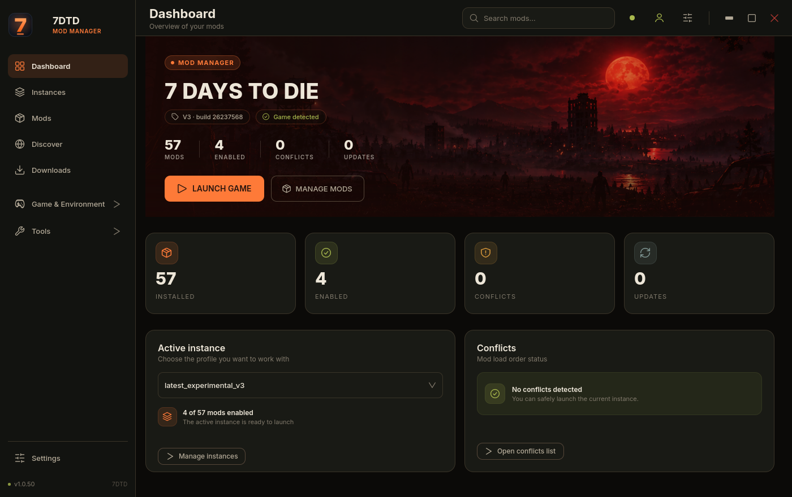<br><sub>Dashboard</sub></td>
<td align="center">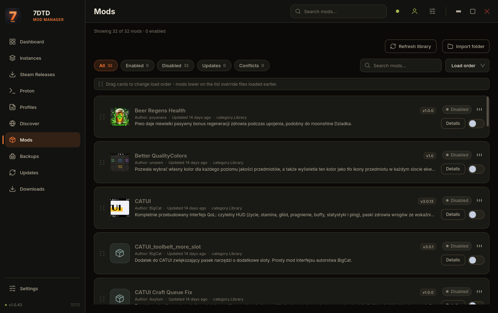<br><sub>Mod library</sub></td>
</tr>
<tr>
<td align="center">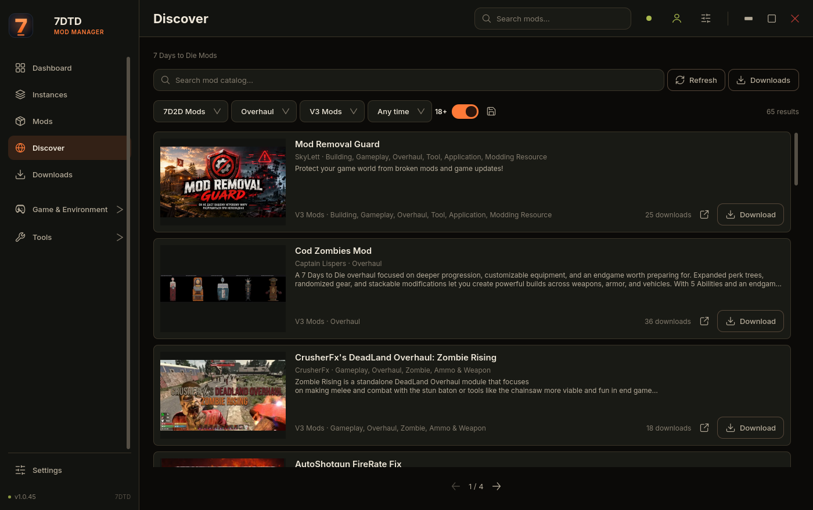<br><sub>Discover</sub></td>
<td align="center">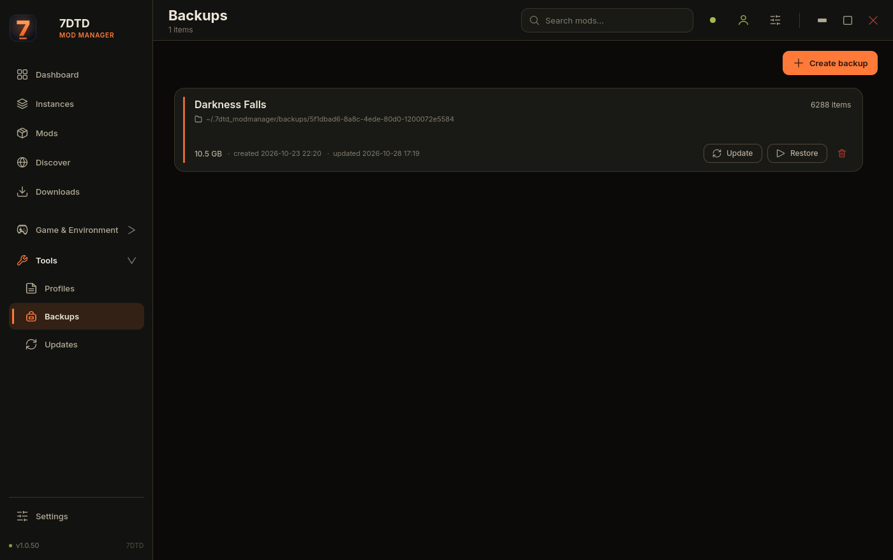<br><sub>Backups</sub></td>
</tr>
<tr>
<td align="center">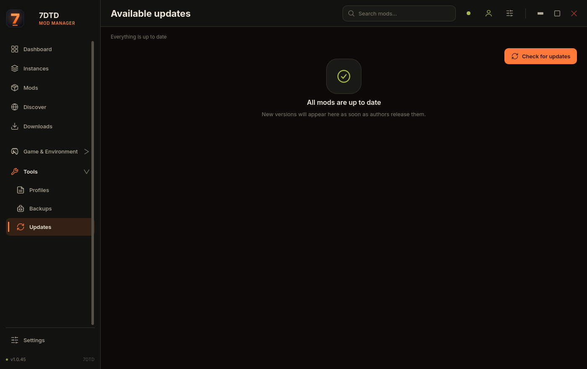<br><sub>Updates</sub></td>
<td align="center">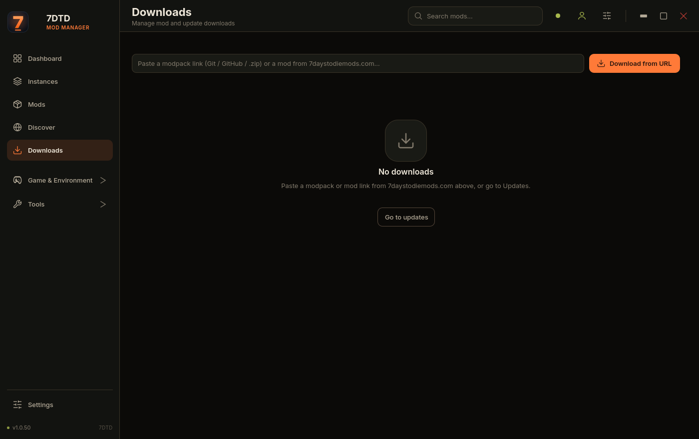<br><sub>Downloads</sub></td>
</tr>
<tr>
<td align="center">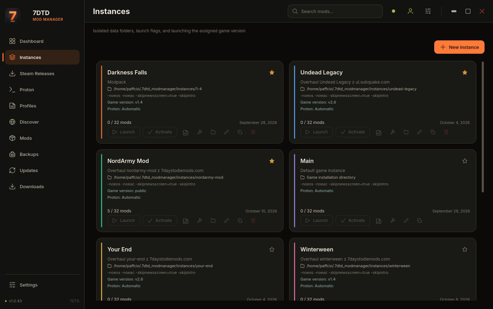<br><sub>Profiles</sub></td>
<td align="center">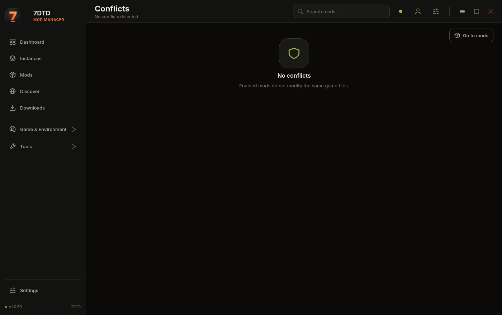<br><sub>Conflicts</sub></td>
</tr>
<tr>
<td align="center">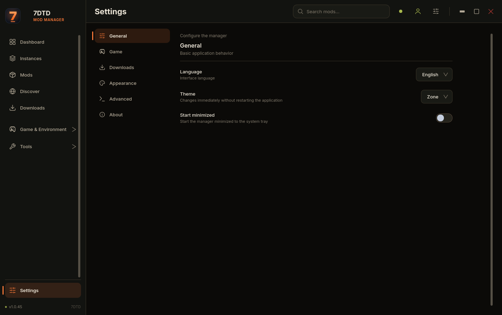<br><sub>Settings</sub></td>
<td align="center">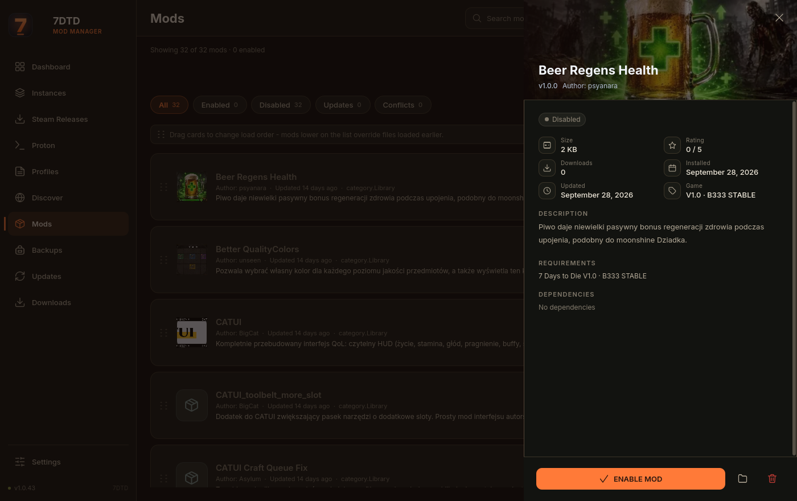<br><sub>Mod details drawer</sub></td>
</tr>
<tr>
<td align="center">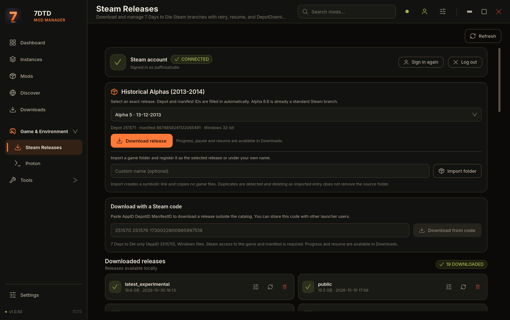<br><sub>Steam releases</sub></td>
<td align="center">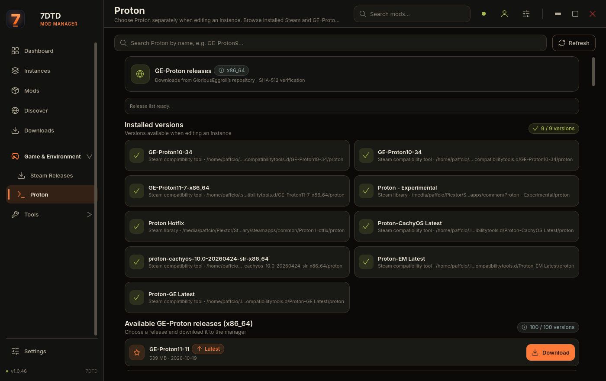<br><sub>Proton versions</sub></td>
</tr>
<tr>
<td align="center">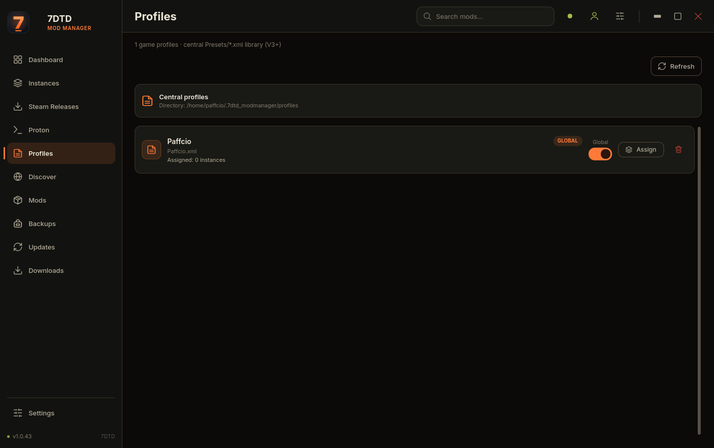<br><sub>Game profiles</sub></td>
<td></td>
</tr>
</table>

After regenerating the screenshots, the three additional sidebar images are available in `docs/screenshots/` alongside the existing page captures.

The supplied archive also contains `docs/screenshots/modpacks-en.png`; the clearer `backups-en.png` filename is used above for the Backups screen.

**Author:** PaffcioStudio
**Platform:** Linux
**Current version:** 1.0.47  

### Instance playtime and browsing

The **Instances** page now records playtime from detected game processes, not from clicks on the Launch button. Every instance shows its cumulative playtime and last confirmed play date; instances not yet played show **Never launched**. The total at the top includes all instances still in your library. Statistics are saved in `~/.7dtd_modmanager/playtime.json` and survive launcher restarts, including a game still running when the manager is reopened. If the game is launched outside the manager, playtime is attributed when the process can be matched to an instance; unknown processes are not guessed. Older playtime from before version 1.0.46 cannot be recovered.

Filter by favorite, played, unplayed, recent (seven days), or running instances. Sort by creation date, last played, total playtime, name, or enabled mods; the arrow reverses the order. Choose **Grid**, **List**, or **Spotlight cards** at the top right. Advanced flags, paths, and Proton choices remain in the instance editor or the information tooltip. Page descriptions now sit under the main page title and shorten with a full-text hover tooltip when the header gets crowded.

**UI languages:** English and Polish
**Default language:** English on a new installation; Polish can be selected in Settings.

## Features

### Mod library

- Centralized local mod library with metadata, versions, source information, target game version, update state, and conflict information.
- Standalone POI prefab downloads (XML + TTS without `ModInfo.xml`) are prepared as standard modlets and stored in the library, without changing the game's original prefab files.
- Enable or disable mods without duplicating the whole library for each instance.
- Import mods from folders and rescan the configured Mods directory.
- Open mod folders, check for updates, update, search online, and uninstall mods.

### Isolated instances

- Create separate game instances with their own data directories and Mods folders.
- Assign a concrete downloaded game branch to each instance.
- Verify that the required branch is actually installed before launch.
- Modpack and overhaul installations carry their required game version into the created instance.
- Modpack/overhaul flows automatically use `-noeos` and `-noeac`.
- Favourite instances stay first in the default creation-date sort and are protected from deletion until the favourite flag is removed. You can also show only favourites with the instance filter.
- Rename, duplicate, edit, activate, rebuild, open folders, and remove instances from one place.

### Steam releases and Steam

- Download and manage specific 7 Days to Die Steam branches through DepotDownloader.
- Keep downloaded branches isolated under `~/.7dtd_modmanager/game-versions/`.
- Treat the normal Steam installation as a separate game source; a current Steam build is never assumed to be compatible with an older modded instance.
- Check the required downloaded branch before launching an instance or downloading a source that requires a particular branch.
- Handle stale DepotDownloader processes, retries, partial downloads, and large download progress safely.
- Support Steam Guard QR authorization and saved Steam session state.
- Show a compact Steam account menu in the header with re-login and logout actions.

### Modpacks and overhauls

- Install supported packages from Git repositories, GitHub releases, and direct ZIP/7z/RAR URLs.
- Browse supported overhaul packages through Discover.
- Reuse cached archives when available.
- Distinguish actual installation state from historical completed download records.

### Discover

- Browse the online 7daystodiemods.com catalog.
- Filter by category, game version, time range, and adult-content visibility.
- Open detailed mod pages and download supported files directly from the launcher.
- Support GitHub-based overhaul sources where the source provides a supported archive.
- Support a dynamic official-page source for actively updated overhauls: the manifest can keep a stable download endpoint while the current release version is refreshed at runtime.
- Show installation state based on real library/instance contents.

### Profiles

- Manage supported V3+ game profiles using the central `Presets/` layout.
- Assign profiles to instances or expose them globally.
- Keep profile handling separated from older game-version layouts where required.

### Backups

- Create full instance backups containing mods, saves, and instance data.
- Restore a backup even after the original instance has been removed.
- Create, refresh, restore, and delete backups from the dedicated page.
- Protect backup operations with data-path and running-game safety checks.

### Updates and downloads

- Check installed mods for newer versions.
- Queue downloads and mod updates in a shared download manager.
- Pause, cancel, retry, and clean supported downloads.
- Reuse cached archives and resume compatible HTTP transfers.
- Display sizes in readable `KB/MB/GB` units.
- Clamp progress and ETA values to safe ranges.
- Keep download byte counters separate from archive extraction/file-count progress.

### Navigation

The sidebar keeps **Dashboard**, **Instances**, **Mods**, **Discover**, and **Downloads** visible at all times. **Game & Environment** contains **Steam Releases** and **Proton**; **Tools** contains **Profiles**, **Backups**, and **Updates**. Both groups can be expanded independently and remember their state across launches. Navigating to a grouped page from elsewhere in the app automatically opens the matching group. Settings and the version indicator remain at the bottom of the sidebar, even when the navigation list needs to scroll.

### Global search

The header search shows instant matches from installed mods and game instances, then adds results from **7daystodiemods.com** in a separate section after a short delay. This internet search is optional and needs a network connection; cached website results are identified when the site is unavailable. Click an online result to see its mod details and downloads in Discover, or press **Enter** / **See all results** to search the full website catalog on the Discover page. The website search ignores saved catalog filters so it does not accidentally hide matching mods. Clicking outside the dropdown, pressing `Esc`, or navigating away closes suggestions. The global search does not automatically download or install mods.

### Themes and localization

- Dark, Light, Stalker, and Stalker Light themes.
- Configurable UI scaling, animations, dashboard artwork rotation, and custom window-frame behaviour.
- Full English/Polish localization for pages, dialogs, buttons, tooltips, placeholders, statuses, notifications, and application-owned folder-picker text.
- The language can be switched without restarting the launcher.

## Requirements

### Runtime

- **Python 3.12** for source development and the current packaging layout.
- **PySide6 >= 6.6, < 7.0**
- **requests**
- **Pillow**

The project uses a local `.venv`, so a global PySide6 installation is not required.

Additional tools are only needed for specific workflows:

- **Steam** for authenticated depot downloads.
- **Proton** for launching downloaded Windows game branches.
- **Git** only for modpack sources that are Git repositories. It is not required by the launcher UI itself.

### Build dependencies

`build.sh` requires: `rsync`, `dpkg-deb`, `curl`, and `python3`. `appimagetool` is downloaded automatically into `.build/` when necessary.

## Get the project from GitHub

The source repository can be downloaded without using Git for project versioning:

1. Open the PaffcioStudio GitHub repository page.
2. Select **Code**.
3. Select **Download ZIP**.
4. Extract the archive and enter the project directory.

Author profile: https://github.com/paffciostudio

The permanent repository URL is not hard-coded here because the project repository path may change before publication.

## Run from source

From the project root:

```bash
./venv.sh
./run.sh
```

`./venv.sh` creates or reuses `.venv` and installs the dependencies from `requirements.txt`.

Run the full automated suite with:

```bash
./test.sh
```

`test.sh` runs pytest from the local virtual environment.

## Build packages

Build both Debian and AppImage packages with:

```bash
./build.sh
```

The script cleans `dist/` and the temporary build tree, assembles the application payload, bundles the Python environment, builds a `.deb`, builds an AppImage, and prints the output paths.

To build and install/update the Debian package in one step:

```bash
./build.sh --install
```

or:

```bash
./build.sh -i
```

Manual Debian installation:

```bash
sudo apt install ./dist/7dtd-mod-manager_<version>_<arch>.deb
```

## Dynamic overhaul sources

Some overhauls do not expose a permanent archive URL. For those entries the manifest stores a stable source such as the official download endpoint and a `dynamic_source` identifier. The launcher refreshes the published version from the official page when the local overhaul catalog is loaded, while the downloader resolves the stable endpoint to the current archive immediately before downloading. This avoids pinning the application to signed Dropbox URLs that can change when the project publishes a new release.

For **Undead Legacy**, the catalog is tied to game branch **v2.6** and uses the official **Download (Mirror)** endpoint. The packaged manifest keeps the last known version as a fallback, but a successful metadata refresh replaces it with the currently published release.

## Game-version safety

A Steam installation is not a universal compatibility layer. If an instance or download source requires a concrete branch, the launcher checks whether that branch is actually downloaded under the local game-version store. Missing branches are reported before the risky operation is attempted.

This prevents an instance created for an older branch from silently launching against a different Steam build.

## Steam account and QR login

Steam authentication is optional until an authenticated depot operation needs it. The header account button exposes the current session state. A saved session opens a compact account menu with **Sign in again** and **Sign out**. A missing session opens the full QR authorization flow.

Logging out only clears the launcher's stored Steam session identity; it does not modify the Steam account itself.

## Application data

Application data is stored under:

```text
~/.7dtd_modmanager/
```

Common locations include:

| Path | Purpose |
| --- | --- |
| `library/`, `library.json` | Local mod library content and its metadata registry |
| `activation.json` | Global and per-instance activation state |
| `instances.json`, `instances/` | Instance registry and default instance data directories |
| `backups/`, `modpacks.json` | Backup folders (one per instance) and the backup registry; `modpacks.json` keeps its historical name |
| `mods/` | Default user Mods folder |
| `downloads/`, `downloads.json` | Downloaded archives and the download queue |
| `installed-archives.json` | Archives from `downloads/` already installed into the library |
| `settings.json` | Application settings |
| `profiles/`, `profiles.json`, `profile-state.json` | Central game profiles, active profile, and profile-to-instance assignments |
| `state.json` | Mod loader state |
| `game-versions/`, `game-versions.json` | Downloaded game branches and their registry |
| `tools/DepotDownloader` | Steam depot downloader tool |
| `steam-account.json` | Saved launcher Steam identity |
| `cache/` | Cached catalog responses, Steam branch list, and mod thumbnails |
| `logs/` | Application logs |

Older builds stored backups in `modpacks/`; the launcher migrates that folder to `backups/` on startup.

## Localization architecture

Translation resources are centralized in:

```text
qml/i18n/
├── I18n.qml
├── qmldir
└── translations.js
```

The Polish and English catalogs use matching keys. Launcher-owned UI text, dialogs, tooltips, placeholders, statuses, and notifications are resolved through the same localization layer.

The custom folder browser is localized by the application. When Qt opens a native operating-system file/folder dialog, the application localizes its own title and filters; the remaining native chrome (for example system navigation labels and standard buttons) is controlled by Qt and the desktop environment and follows the system locale.

## Project layout

```text
assets/                 Icons, fonts, artwork
docs/screenshots/       English UI screenshots used by this README
qml/                    QML UI, components, theme, localization
src/                    Python backend and services
tests/                  Automated tests
scripts/                Desktop integration helpers
tools/                  Development utilities
build.sh                Debian/AppImage packaging
run.sh                  Source launcher using .venv
venv.sh                 Development environment setup
test.sh                 Test-suite entry point
requirements.txt        Python dependencies
```

## Troubleshooting

### Launcher does not start

From the project root, run:

```bash
./run.sh
```

If `.venv` is missing, run:

```bash
./venv.sh
```

### Select or download Proton

Edit an instance and choose **Proton version**. **Automatic** keeps Steam’s selection for Steam launches and lets the manager choose an installed Proton for downloaded game copies. An explicit selection starts the Windows client directly with that Proton; a missing selected version blocks launch. The selection is preserved when duplicating an instance.

The **Proton** page lists installed Steam/custom compatibility tools and downloads x86_64 GE-Proton releases from [the author’s repository](https://github.com/GloriousEggroll/proton-ge-custom/releases). Downloads are verified with SHA-512 and installed into `~/.7dtd_modmanager/protons/`. Only manager-installed versions can be removed here, and versions assigned to an instance are protected.

### Find instance logs and crash reports

Use the **Logs** button on an instance card to preview text logs, open a file, or open its folder. This includes game logs, launcher logs, Proton debug logs and Unity crash reports inside the Wine prefix. Shared-prefix reports are labelled; compare their timestamp with your launch. Previews show the last 256 KB.

Direct Proton launches enable `PROTON_LOG` and save `steam-251570.log` and `game-launch.log` into `<instance>/logs/`. Steam-managed automatic launches keep Steam’s own logging behavior.

### A required game branch is missing

Open **Steam Releases**, authenticate with your own Steam account when required, and download the branch needed by the instance or mod source. Steam verifies your entitlement to the game; neither the app nor DepotDownloader can grant access to a branch your account is not authorized to download.

### A particular mod cannot be downloaded

Mods are fetched from their authors' sources, not from your Steam account. A download may be unavailable because the file was removed, its link has expired, the host blocks automated requests (including HTTP 403), the host requires its own login, or no file matches the selected game version. **Steam login will not unlock inaccessible third-party mod files.** Check the available files in the mod details, try a legitimately provided archive from its author and import it manually, or report the failing URL together with the download log.

### Does the launcher check for application updates?

Yes. By default the manager checks GitHub for a newer published release on startup. This can be disabled, and a manual **Check now** action is available under **Settings**. The update dialog shows the relevant release notes and opens the release page if you want to download it. It does not silently replace the installed app. The **About → FAQ** section covers these questions and more in Polish and English.

### Mods bundled with the game also appear in an instance

Before launching a Steam installation or a downloaded game branch, the manager checks for duplicate mods in the game's `Mods` directory and the instance's `Mods` directory. It compares folder names, `Name` from `ModInfo.xml`, and the TFP Harmony wrapper files. The instance's version takes precedence.

The duplicate's descriptor is moved to `<game>/.modmanager-disabled-mods/<mod>/ModInfo.xml`. DLLs and resources remain in their original locations. On the next launch through the manager, a game mod is restored if the selected instance no longer supplies it. Backups survive a manager or game crash. Starting the game outside the manager does not restore these descriptors; launch the default instance through the manager first. If Steam recreates a disabled descriptor or a game mod is symlinked, the manager blocks launch instead of overwriting files or changing the shared source. Details are recorded in the launcher log.

### Discover shows a package as downloaded even after deleting the instance

The launcher checks actual installed library/instance content instead of trusting a historical `completed` queue entry on its own.

### Download progress shows a strange value

Progress values are clamped to safe ranges, negative sizes are normalized, large values are displayed using human-readable units, and download bytes are kept separate from extraction/file-count progress.

## Disclaimer

7DTD Mod Manager is an independent, community-made tool. It is not affiliated with, endorsed by, or connected to The Fun Pimps (creators of 7 Days to Die) or any of the websites it integrates with.

The Discover feature uses the public API and catalog of [7daystodiemods.com](https://7daystodiemods.com). All mods, descriptions, and files available through it belong to their respective authors - if you enjoy a mod, support its author.

## License

This project is licensed under the MIT License. See the [LICENSE](LICENSE) file for details.

## Author

**PaffcioStudio**
https://github.com/paffciostudio


### ZIP / 7z / RAR mod archives

The launcher supports ZIP, 7z and RAR archives from Discover, direct download
links and GitHub Releases. 7z and RAR extraction uses the native `libarchive`
library. On Tuxedo OS / recent Ubuntu releases, install it with
`sudo apt install libarchive13t64`; on older releases use
`sudo apt install libarchive13`. The DEB package declares the dependency
automatically. AppImage users need to have the library installed on the host.
No external `7z` or `unrar` command is required.

When the author has not specified a reliable game version, Discover lets you
download the selected file after acknowledging a compatibility warning. Files
known to be incompatible with the selected game version remain blocked.
Downloading an unverified file does not guarantee it will work with your game.
